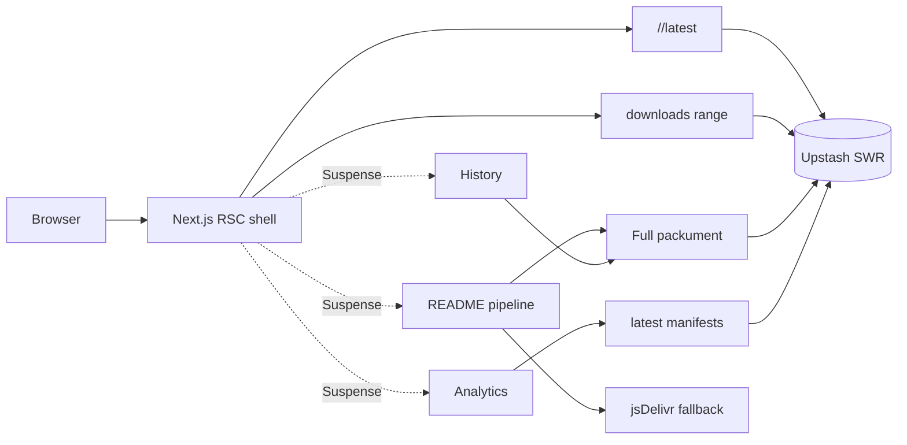

# npmsearch

**A fast, minimal browser for the npm registry.** Dense package data, instant
search, keyboard-first navigation, a streamed README pipeline, and a quiet
terminal-inspired interface.

[](https://github.com/thegeekyb0y/npmsearch/actions/workflows/ci.yml)
[](LICENSE)


**[Live app](https://npmsearch121.vercel.app)** ·
**[How it works](https://npmsearch121.vercel.app/how-it-works)** ·
**[Contributing](CONTRIBUTING.md)**

## Why this exists

The npm website is built for the whole ecosystem: publishing, teams, billing,
marketing and accounts. Most of the time I just want to answer a smaller
question:

> What does this package do, how big is it, what does it depend on, and is its
> README useful?

npmsearch is built around that question. It reads the public registry directly,
keeps the interface quiet, and spends its complexity budget on speed:

- the package shell renders from a **small manifest**, not a 31 MB packument
- heavy sections **stream** after the shell
- every slow upstream is cached with **stale-while-revalidate**
- typing never triggers a server render per keystroke
- search results are **virtualized** up to 1,000 rows

## How it compares

| Capability | npmjs.com | npmsearch |
| --- | --- | --- |
| Package search | ✅ | ✅ |
| Package details & README | ✅ | ✅ |
| Version history | ✅ | ✅ |
| Direct dependencies | ✅ | ✅ |
| Download charts | ✅ | ✅ |
| Dark mode | ✅ | ✅ |
| TypeScript types indicator | ✅ | ✅ |
| **Install size estimate** | ❌ | ✅ |
| **Outdated dependency flags** | ❌ | ✅ |
| **ESM / CJS / types badges** | ❌ | ✅ |
| **Interactive, keyboard-inspectable chart** | ❌ | ✅ |
| **Keyboard navigation & command palette** | ❌ | ✅ |
| **Streamed package shell** | ❌ | ✅ |
| **README TOC + copy buttons** | ❌ | ✅ |
| **Missing-README fallback** | ❌ | ✅ |
| **Short routes (`/react`, `/react@19`)** | ❌ | ✅ |
| **Open source** | ❌ | ✅ |
| Publishing, orgs, billing | ✅ | ➖ |

npmsearch is intentionally read-only: it is an explorer, not a publishing
dashboard.

## Features

- **Instant search** — 100 ms debounce, `AbortController`, client cache, URL sync.
- **Virtualized results** — 1,000-result cap without a heavy DOM.
- **Keyboard layer** — `/` focus, `Cmd/Ctrl+K` palette, arrows, Enter, Escape.
- **Package shell** — license, deps, unpacked size, files, node range.
- **Interactive downloads chart** — 30-day trend, pointer crosshair, keyboard
  inspection, weekly/monthly totals.
- **Dependency health** — direct deps, declared range, latest version, outdated
  flags, ESM/CJS/types badges.
- **README pipeline** — registry first, jsDelivr fallback, sanitize, Shiki, TOC,
  copy buttons.
- **Short routes** — `/<pkg>` and `/<pkg>@<version>`, including scoped names.
- **Responsive and accessible** — 360 / 768 / 1280, axe checks, reduced motion.

## Architecture



The shell is built from `/<pkg>/latest` + downloads. README, analytics and
history stream in separate Suspense boundaries; the full packument is shared
through React `cache()`. The full engineering story, diagrams and tradeoffs live
at [`/how-it-works`](https://npmsearch121.vercel.app/how-it-works).

[](https://npmsearch121.vercel.app/how-it-works)

## Performance

| Decision | Budget / result |
| --- | --- |
| Package shell source | `/<pkg>/latest` + downloads, not the full packument |
| Search debounce | 100 ms, leading + trailing |
| Search results | 1,000 cap, window-virtualized |
| README | 256 KB cap, server-highlighted, streamed |
| Install-size crawl | depth 3 · 60 packages · 8 concurrent · 2 s |
| Cache TTLs | search 60 s/1 h · package 5 m/24 h · analytics 1 h/24 h · README 1 d/7 d |
| Home route | static, daily revalidation for the GitHub star count |
| Client search cache | 60 s, 20 entries |

## Tech stack

| Layer | Choice |
| --- | --- |
| Framework | Next.js 16 App Router, React 19 Server Components |
| Language | TypeScript, strict |
| Styling | Tailwind CSS v4, CSS-first tokens |
| Data | npm registry + downloads API, Zod validation |
| Cache | Upstash Redis, stale-while-revalidate |
| README | react-markdown, rehype, Shiki, github-slugger |
| Motion | `motion` (`motion/react`) |
| Icons | `lucide-react`, Simple Icons for the stack page |
| Tests | Vitest, Playwright, axe |
| Hosting | Vercel |

## Getting started

```bash
pnpm install
cp .env.example .env
pnpm dev
```

Open <http://localhost:3000>.

The app runs without secrets. Upstash and the GitHub token are optional and
degrade gracefully.

### Scripts

| Command | Purpose |
| --- | --- |
| `pnpm dev` | Development server |
| `pnpm build` | Production build |
| `pnpm start` | Serve the production build |
| `pnpm lint` | ESLint |
| `pnpm typecheck` | `tsc --noEmit` |
| `pnpm test` | Vitest |
| `pnpm test:e2e` | Playwright (install Chromium once) |

### Environment

| Variable | Required | Purpose |
| --- | --- | --- |
| `UPSTASH_REDIS_REST_URL` | production | Shared SWR cache |
| `UPSTASH_REDIS_REST_TOKEN` | production | Shared SWR cache |
| `NEXT_PUBLIC_BASE_URL` | no | Fallback origin for local tooling |
| `GITHUB_TOKEN` | no | Stars/forks/issues on package pages |

Never commit `.env`.

## Project structure

```text
app/
  page.tsx                 landing page
  search/page.tsx          search shell
  package/[name]/          long-form package route
  [...pkg]/                /<pkg> and /<pkg>@<version> aliases
  how-it-works/            engineering page
  api/search/              client search adapter
  components/              UI primitives and islands
  lib/                     registry, cache, analytics, README, format
tests/
  unit/                    Vitest
  e2e/                     Playwright
```

## Keyboard

| Key | Action |
| --- | --- |
| `/` | Focus the global search |
| `Cmd/Ctrl+K` | Open the command palette |
| `ArrowDown` | Move from the input into results |
| `ArrowUp/Down` | Navigate results |
| `Home` / `End` | Jump to the first or last result |
| `Enter` | Open the focused package |
| `Escape` | Close the palette or return to search |

## Contributing

Contributions are welcome. Start with [CONTRIBUTING.md](CONTRIBUTING.md), the
[Code of Conduct](CODE_OF_CONDUCT.md), and the open issues labelled
**good first issue**.

The planned AI package finder is discussed in the
[AI search issue template](.github/ISSUE_TEMPLATE/ai_search.yml). The model will
plan the search; the registry remains the source of truth.

## License

[MIT](LICENSE) © thegeekyb0y
